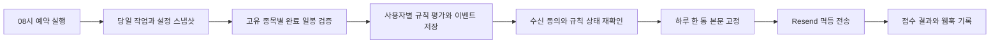

# 종가 기준 관심종목 알림 서비스 확장 계획

작성일: 2026년 10월 23일. 구현 기준: `main`의 `5e6f5eb`.
상태: 2026-10-23 개발 구현 및 로컬 검증 완료, 운영 미활성화. 10종 평가·계정별 API·일봉 검증·화면·메일 원장을 구현했다. 최신 설정은 [운영 문서](../stock-alerts-operations.md), 검증 결과와 차이는 [구현 검토](../reviews/2026-10-23-stock-alert-implementation.md)를 따른다. 아래는 최초 설계 명세이며 모든 운영 검증이 완료됐다는 의미는 아니다.

Google 로그인 사용자가 보유 여부와 관계없이 관심종목과 조건을 등록하고,
한국·미국 정규장 종가로 확인된 새 신호를 한국시간 오전 8시대에 한 통으로 받는 기능을 만든다.
기존 FastAPI·vanilla JavaScript·pandas와 계정 인증을 유지한다.
새 알림은 기존 보유자산·목표·위젯 배치와 분리하여 저장한다.

## 확정 범위와 설계 기본값

### 사용자가 선택한 범위

- 운영자만이 아니라 Google 로그인 사용자 전체가 이용한다.
- 한국과 미국 주식·ETF를 지원하며, 관심종목 등록에 보유 수량이나 매입가를 요구하지 않는다.
- 가격·기술 지표 알림 10종을 모두 구현한다. 200일선만 구현하고 전체 작업을 완료 처리하지 않는다.
- 장중·시간외 가격으로 발송하지 않는다. 정규장 종료 후 검증한 일봉으로 판정한다.
- 한국시간 아침 8시에 한국·미국 결과를 모은 통합메일을 받는다.
- 기능별 테스트를 작성하고 작업별 커밋 후 푸시한다.

### 구현에 사용할 기본값

아래는 사용자가 별도로 확정한 선택과 구분되는 설계 기본값이다.
추가 답변이 도착하면 문서를 먼저 고치고 구현한다. 답변이 없으면 이 안으로 개발하되
유료 계정 생성·결제·운영 발송은 자동으로 수행하지 않는다.

| 항목 | 기본값 |
| --- | --- |
| 신규 알림 저장 | PostgreSQL, 운영 배포는 Neon의 pooled 연결 |
| 신규 메일 발송 | Resend HTTP API와 검증된 발신 도메인 |
| 운영 일봉 공급 | Twelve Data Business, 한국·미국 주식/ETF 및 외부 이용 범위 계약 확인 후 활성화 |
| 개발 데이터 | 고정 OHLCV fixture. 기존 yfinance는 개인 검증용에 한정하고 신규 공개 알림 공급자로 사용하지 않음 |
| 예약 실행 | Vercel Pro Cron, 매일 UTC `*/5 23 * * *`, 한국시간 08:00~08:55 재개 실행 |
| 시간 약속 | 08:00부터 점검하여 08시대 발송을 목표로 함. 정확한 수신함 도착 시각은 보장하지 않음 |
| 무신호일 | 메일을 보내지 않음. 화면에는 정상 무신호·휴장·점검 실패를 구분 |
| 수신 주소 | Google 로그인으로 검증된 본인 이메일만 사용 |
| 활성 규칙 상한 | 계정당 100개, 관심종목 50개 |
| 첫 출시 검증 규모 | 50명·고유 종목 100개·규칙 5,000개. 이는 인수시험 기준이며 실측 성능 주장이 아님 |

Vercel Hobby는 하루 한 번과 시간대 단위 실행만 지원하므로 재개 가능한 운영안의 기본으로 삼지 않는다.
Resend의 멱등 요청 키 보관은 24시간이므로 재시도도 그 범위 안에서만 한다.
[Vercel 공식 제약](https://vercel.com/docs/cron-jobs/usage-and-pricing),
[Resend 공식 멱등성 설명](https://resend.com/docs/dashboard/emails/idempotency-keys)

실적·배당 일정, 뉴스, 공시, 장중 알림, 암호화폐, 자동 주문, AND/OR 복합 조건,
여러 시간봉 조합과 돌파 후 재접근 조건은 이번 구현에 포함하지 않는다.
이들은 후속 단계에 기록만 하며 현재 규칙 스키마에 미사용 실행 엔진을 만들지 않는다.

## 현재 코드와 재사용 경계

| 현재 구성 | 새 기능에서의 처리 |
| --- | --- |
| `app/auth.py`의 Google 검증·세션·Origin·계정 변경 검사 | 재사용. 신규 알림 API에도 동일하게 적용 |
| 종목 검색과 종목명 표시 | 화면은 재사용. 등록 시 서버가 공급자의 거래소·종목 유형·통화를 재검증 |
| `compute_rsi`와 pandas | RSI 동작을 고정 fixture로 검증한 뒤 재사용 |
| 대시보드 최근 5일 quote | 화면용으로 유지. 장기 지표·종가 확정 판단에 재사용하지 않음 |
| 백테스트의 다종목 공통 날짜 정렬 | 유지. 신규 알림에서는 종목별 세션을 평가하며 시장간 교집합을 만들지 않음 |
| Blob의 보유자산·목표·배치 | 현재 경로·스키마·ETag 계약 유지. PostgreSQL로 자동 이전하지 않음 |
| 운영자 전용 Gmail SMTP·리밸런싱 메일 | 기존 기능의 전환 절차만 추가. 신규 일반 사용자 메일로 확장하지 않음 |
| 대시보드 로딩 표시·브라우저 테스트 기반 | 새 알림 화면에서도 같은 방식으로 표시하고 재사용 |

새 알림 DB가 없거나 장애가 나도 기존 대시보드와 실험실을 계속 이용할 수 있어야 한다.
알림 API만 503과 설정 안내를 반환한다. OAuth 로그인 성공을 새 DB 장애 때문에 실패시키지 않는다.

## 사용자 흐름과 화면

### 진입과 관심종목

- `/alerts`에 별도 알림 화면을 추가하고 대시보드 사이드바에 연결한다.
- 비로그인 상태에는 기능 설명과 로그인 링크를 표시한다. 개인 데이터 API는 401을 반환한다.
- 첫 진입 시 세션에서 사용자 식별자와 검증 이메일을 동기화한다. 로그인만으로 구독하지 않는다.
- 관심종목 검색 → 종목명·코드·거래소·통화 확인 → 추가 순서로 동작한다.
- 보유자산에서 가져오기 버튼은 현재 보유 종목을 선택해 추가하는 편의 기능으로만 둔다.
  보유 목록 변경이나 매도 때문에 관심종목·규칙을 자동 삭제하지 않는다.
- 관심종목 제거는 연결 규칙을 함께 중지·보관 처리하고 과거 이력을 유지한다.
  종목 재추가로 과거 규칙을 자동 재활성화하지 않는다.

### 규칙과 수신 설정

- 종목마다 여러 규칙을 등록할 수 있다. 템플릿은 200일 SMA 양방향 돌파, 50/200 SMA 교차,
  일간 ±5%, RSI 30 하향·70 상향을 제공한다.
- 기간·방향 등을 고르면 “AAPL 종가가 200거래일 단순이동평균을 아래에서 위로 돌파한 날”처럼
  실제 판정 의미를 문장으로 표시한다. 숫자와 기간의 단위를 함께 적는다.
- 같은 규칙을 여러 관심종목에 일괄 등록한다. 서버가 정규화한 종목·유형·매개변수 조합의 중복은 만들지 않는다.
  일괄 등록은 한 트랜잭션으로 처리하고 검증 오류가 하나라도 있으면 전체를 거절한다.
- 등록·수정·정지·재개·삭제를 지원한다. 삭제는 이력 보존을 위한 보관 처리다.
- 규칙 저장과 메일 수신 동의를 분리한다. 메일이 꺼져 있어도 설정·최근 판정은 확인할 수 있다.
- 수신 동의 화면에는 본인 주소, 종가 기준, 오전 8시대, 무신호일 미발송을 명시한다.
- Google 이메일이 바뀌면 서버가 새 주소를 반영하고 메일을 중지한다. 새 주소에서 다시 동의해야 한다.
  클라이언트가 임의 이메일·사용자 ID·발신자를 지정하지 못하게 한다.
- 화면에는 “새 신호”, “정상 무신호”, “휴장으로 새 거래일 없음”, “자료 준비 중”,
  “계산 자료 부족”, “조회 실패”, “발송 실패”, “결과 확인 필요”를 구별해 표시한다.
- 요청 중 로딩 문구와 아이콘을 표시하고, 저장 중 중복 제출을 막으며 실패해도 입력을 보존한다.
  모바일 및 키보드·스크린리더 사용을 기존 화면 수준으로 지원한다.

### 첫 등록과 변경의 적용 시점

- 규칙을 등록·재개하거나 계산 조건을 바꾸면 `activatedAt`과 새 의미 버전을 기록한다.
- `activatedAt` 전에 이미 종료된 시장 세션은 자동 메일 대상이 아니다.
  이미 선 위에 있는 종목을 등록했다고 새로운 상향 돌파로 만들지 않는다.
- 최초 화면에는 현재 조건 상태만 표시하고, 활성화 후 종료되는 세션부터 발송 대상으로 평가한다.
- 이름만 바꾸면 표시 revision만 증가한다. 종목·유형·매개변수 변경 및 재개는 의미 버전을 증가시킨다.
- 정지 기간의 신호와 재개 이전 신호는 소급 발송하지 않는다.
- 오전 8시 뒤 만든 규칙은 다음 예약 실행부터 포함한다.
  발송 직전 정지·해지·삭제는 해당 날짜에도 적용한다.
- 기존 규칙이 08:00 뒤 계산 조건 수정되면 그날 이전 버전의 미발송 신호를 제외하고 다음 날부터 새 버전을 적용한다.

## 일봉과 지표 데이터 계약

### 종목 식별과 시장 세션

정규화 식별자는 현재 서비스와 호환되는 `AAPL`, `005930.KS`, `247540.KQ`를 사용한다.
서버는 별도로 공급자 symbol, MIC, 자산 유형, 현지 통화, IANA 시간대와 달력을 저장한다.
한국은 `Asia/Seoul`·XKRX 달력을 사용하고, 미국 주식·ETF는 `America/New_York`와 해당 거래소 달력을 사용한다.
지원 밖의 OTC·지수·암호화폐·KONEX·파생상품은 등록 시 거절한다.
미국 특수 세션이 달력에 없으면 임의 평일로 대체하지 않고 보류한다.

`digestDate`는 한국시간 발송일이고 `sessionDate`는 해당 거래소 현지 거래일이다.
두 날짜는 같을 필요가 없다. 한국만 휴장해도 미국 종목은 독립적으로 평가한다.
미국 서머타임·조기폐장·한국 임시휴장은 `exchange_calendars`의 검증한 달력으로 처리한다.
장래 특별 휴장 변경은 달력 버전 갱신과 운영 fixture 추가 대상으로 둔다.

오전 08:00 KST를 하루의 데이터 마감 기준으로 고정한다.
그 시각보다 90분 이상 전에 정규장이 종료된 최신 세션이 각 시장의 기대 완료 세션이다.
공급자의 해당 일봉 날짜가 기대 세션과 일치해야 하며, 장중·시간외 자료는 제외한다.
최종 확정 플래그가 있으면 확인하고, 없으면 마감 후 시간·날짜 검증과 5분 이상 간격의 동일 내용 두 번 확인을 사용한다.
이는 공급 데이터 검증 절차이며 거래소의 사후 정정이 없다는 보장은 아니다.
미입고 세션을 과거 봉이나 임의 forward-fill로 대체하지 않는다.

### 공급자와 정규화

알림 전용 로더를 추가한다. 기존 백테스트 `MarketData` 반환 계약은 바꾸지 않는다.
Twelve Data의 일봉·기업분할·종목 메타데이터 응답을 내부 계약으로 정규화한다.
최초 조회는 가능한 최근 1,500개 완료 일봉을 확보하고 이후 증분 저장한다.
출시 버전에서는 지표 시작 기준이 흔들리지 않도록 저장한 최초 기준 이후 시계열을 임의 절단하지 않는다.
조회 기간이 짧은 신규 상장 종목은 규칙별 최소 자료 개수로 판단한다.

일봉 요청은 `interval=1day`, `adjust=none`으로 raw 자료를 받고 공급자 날짜·MIC·통화를 확인한다.
보정과 API 파라미터의 실제 의미는 공급자 fixture로 고정한다.
증분 수집에서는 최근 10개 봉을 다시 확인하고, 새 분할이 있으면 저장 구간 전체를 재보정한다.
소급 평가의 각 t에서는 t 이후 기업행동이나 미래 봉을 참조하지 않는다.

필수 값은 종목, 세션 날짜, raw OHLCV, 분할 내역, 공급자, 수집 시각, 검증 상태,
스냅샷 해시, 가격 보정 정책 버전이다. 현금배당은 기술적 가격선에 재투자하지 않는다.

- 양수 유한 OHLC, 0 이상 유한 Volume, 날짜 중복 없음, 시간순 정렬을 검증한다.
- split 비율은 신규 주식 수/기존 주식 수다. 기준 세션까지 이후 발생한 비율 곱이 F이면
  과거 OHLC는 raw/F, 거래량은 raw×F로 정규화한다. 역분할도 같은 식을 쓴다.
- 지표와 전일 대비 등락률은 같은 기준 세션의 분할 보정·현금배당 미조정 시계열로 계산한다.
  지정가격은 해당 세션의 실제 거래 통화 종가와 비교한다.
- 분할이 발생하면 지정가격 규칙은 자동으로 가격을 변경하지 않고 `needs_review`로 일시정지한다.
  사용자가 목표가격을 확인하고 재개해야 한다. 다른 지표는 분할 보정 이력을 검증한 뒤 평가한다.
- 분할 내역을 확인할 수 없거나 히스토리 중간 봉이 누락되면 추정 보정을 하지 않는다.
  거래정지가 확인된 날짜와 단순 데이터 누락을 구분하며, 확인되지 않은 누락은 `data_gap`으로 보류한다.
- 같은 실행에서 이전·현재 값을 각각 다른 응답으로 계산하지 않는다. 지표는 하나의 스냅샷을 공유한다.
- 이미 발송한 신호가 사후 정정으로 달라져도 자동 정정 메일을 보내지 않는다.
  정정 상태를 화면과 감사 기록에 표시한다. 다음 평가에는 새 스냅샷을 사용한다.

Twelve Data는 한국 XKRX·XKOS와 미국 EOD 시장을 표기하며 가격 보정 모드를 제공한다.
다만 개별 한국 ETF·기업행동·거래량 보정의 실제 커버리지와 외부 알림 이용 권한은 배포 전 계약·표본 검증으로 확인한다.
지원되지 않는 종목은 등록 시 명확히 알리고 다른 공급자를 몰래 혼합하지 않는다.
[거래소 목록](https://twelvedata.com/exchanges), [API 문서](https://twelvedata.com/docs),
[사업용 이용 범위](https://twelvedata.com/pricing-business)

### 계산 공통 규칙

`C[t]`는 위 정책의 종가, `V[t]`는 거래량, t−1은 직전 유효 완료 거래세션이다.
교차는 다음 식으로 통일한다. 화면에 반올림한 값으로 계산하지 않는다.

```text
상향 교차(A, B): A[t-1] <= B[t-1] 이고 A[t] > B[t]
하향 교차(A, B): A[t-1] >= B[t-1] 이고 A[t] < B[t]
```

정확히 선에 닿은 당일은 돌파가 아니다. 선 위·아래에 계속 있으면 새 교차도 아니다.
수식 내부에서 NaN·무한대·0 분모를 정상 false나 0으로 치환하지 않는다.

- SMA는 pandas rolling 평균, 유효 개수 n개를 요구한다.
- EMA는 `ewm(span=n, adjust=False, min_periods=n)`으로 고정한다.
  최초 종가를 재귀 시작값으로 사용한다. 다른 앱의 SMA seed 방식과 결과가 다를 수 있음을 도움말에 적는다.
- RSI는 현재 `compute_rsi`의 Wilder형 EWM 계산을 유지한다. 상승·하락 모두 0이면 50,
  평균 손실만 0이면 100이라는 기존 정책을 테스트로 고정한다.
- MACD는 위 EMA(fast)−EMA(slow), 시그널은 유효 MACD의 EMA(signal)다.
- 볼린저 표준편차는 `ddof=0`이다.
- 초기 적재 시 결정한 시작 봉 이후 같은 데이터로 재계산하면 같은 결과가 나와야 한다.
  공급자·지표 정책 버전이 바뀌면 이전 버전과 교차 비교하지 않고 새 기준선을 설정한다.

## 알림 10종 명세

모든 기간은 달력 날짜가 아닌 유효 완료 일봉 개수다.
공통 방향은 `up`, `down`, `both` 중 해당 유형이 허용하는 값이다.
같은 규칙·버전·세션·발동 종류는 한 번만 기록한다.

| 유형 ID | 매개변수와 기본값 | 발동 및 반복 정책 | 최소 봉 |
| --- | --- | --- | --- |
| `price_ma_cross` | 평균 `sma/ema`, n=200, 방향 both | C와 MA(n)의 교차. 새 교차일만 발동 | n+1 |
| `ma_cross` | 평균 `sma/ema`, short=50, long=200, 방향 both | 단기선과 장기선 교차. `short<long` 필수 | long+1 |
| `price_cross` | 현지 통화 가격, 방향 both | 실제 종가와 지정가격 교차. 분할 발견 시 확인 전까지 정지 | 2 |
| `daily_change` | pct=5, 방향 both | `100×(C[t]/C[t-1]−1)`이 상승 +p 이상 또는 하락 −p 이하. 충족 거래일마다 발동 | 2 |
| `rsi_cross` | n=14, level=30, 방향 down | RSI와 기준값 교차. 30 하향 진입과 30 상향 회복은 별도 규칙으로 설정 | n+2 |
| `range_breakout` | n=252, 방향 both | C[t]가 직전 n개 종가의 최대보다 크거나 최소보다 작음. 당일 제외, 동률 제외. 갱신일마다 발동 | n+1 |
| `volume_spike` | n=20, multiple=2 | V[t]가 직전 n개 거래량 평균의 배수 이상. 당일 제외. 평균 0이면 평가 불가. 충족일마다 발동 | n+1 |
| `macd_cross` | fast=12, slow=26, signal=9, mode=`signal/zero`, 방향 both | MACD와 시그널 또는 0의 새 교차. `fast<slow` 필수 | signal 모드 slow+signal, zero 모드 slow+1 |
| `bollinger_cross` | n=20, stddev=2, event=`upper_exit/lower_exit/upper_reentry/lower_reentry` | 상단 위 돌파/하단 아래 이탈/상단 아래 복귀/하단 위 복귀를 각 시점 밴드와 비교. 새 교차만 발동 | n+1 |
| `drawdown_cross` | n=60, pct=10 | H[t]=당일 포함 최근 n개 최고 종가, D[t]=100×(1−C[t]/H[t]). D[t-1]<p이고 D[t]>=p일 때만 발동. p 아래로 회복한 뒤 재진입 가능 | n+1 |

입력 범위는 기간 2~252 정수, RSI 기준 1~99, 일간 변동률 0.1~50%,
낙폭 0.1~90%, 거래량 배수 1.1~20, 볼린저 배수 0.5~5로 고정한다.
가격은 유한 양수이며 최대 1,000,000,000 현지 통화 단위다.
MACD 각 기간도 2~252이며 `fast<slow`를 검증한다.
매개변수 객체는 유형별 Pydantic 모델로 검증하고 정의되지 않은 필드를 거절한다.

실제 `params` 필드명은 다음으로 고정한다. 표의 n은 `period`, pct는 `thresholdPct`다.

```text
price_ma_cross: average, period, direction
ma_cross: average, shortPeriod, longPeriod, direction
price_cross: price, direction
daily_change: thresholdPct, direction
rsi_cross: period, level, direction
range_breakout: period, direction
volume_spike: period, multiple
macd_cross: fastPeriod, slowPeriod, signalPeriod, crossMode, direction
bollinger_cross: period, stddev, event
drawdown_cross: period, thresholdPct
```

예를 들어 `price_ma_cross` 200일 SMA의 전일·당일 계산에는 최소 201개 완료 일봉이 필요하다.
자료가 200개뿐이면 “돌파 없음”이 아니라 “자료 부족”이다.
거래량 급증·일간 급등락·기간 신고가 갱신은 새 교차 전용 규칙과 달리 조건을 만족한 거래일마다 신호가 생긴다.
이 차이를 등록 확인 문장과 도움말에 표시한다.

## 저장 모델과 일관성

새 PostgreSQL 스키마만 추가한다. ORM 없이 psycopg 3의 매개변수 SQL·트랜잭션을 사용한다.
운영에서는 Neon pooled URL에 TLS로 연결한다. 요청마다 짧은 연결을 사용하고 네트워크 호출 중 트랜잭션을 유지하지 않는다.
마이그레이션은 번호 있는 SQL과 적용 버전·체크섬 원장으로 실행하며 자동 앱 시작 시 실행하지 않는다.

| 논리 테이블 | 필수 데이터와 제약 |
| --- | --- |
| `alert_users` | UUID PK, Google sub UNIQUE, 검증 이메일, 동의 여부/시각, revision, unsubscribeVersion, suppression 사유, legacy 전환 상태 |
| `alert_instruments` | UUID PK, canonicalSymbol UNIQUE, providerSymbol+MIC UNIQUE, 이름/자산유형/통화/시간대/달력, 공급자 정책 버전 |
| `alert_watchlist` | userId+instrumentId UNIQUE, 등록/보관 시각 |
| `alert_rules` | UUID PK, userId/instrumentId, type/params JSONB, enabled/archived, revision/meaningVersion, activatedAt, 마지막 평가 세션·결과·이유 |
| `alert_daily_bars` | instrumentId+sessionDate+policyVersion PK, raw/보정 OHLCV, split metadata, 검증·해시·수집시각 |
| `alert_runs` | digestDateKST UNIQUE, cutoff/deadline, 사용자·규칙 스냅샷, 진행/오류 개수와 상태, 실행 lease와 공급자 분당 사용 credit |
| `alert_tasks` | runId+kind+targetId UNIQUE, fetch/evaluate/send 작업, 상태·시도 횟수·nextAttemptAt·leaseToken/leaseUntil·오류 |
| `alert_events` | userId/ruleId/meaningVersion/instrumentId/sessionDate/triggerKind UNIQUE, 당시 조건·관측값·이유·스냅샷 해시, digestId |
| `alert_digests` | userId+digestDateKST UNIQUE, 본문·수신주소·eventIds·해시, 상태/attempt/접수ID/시각·안전한 오류 코드 |
| `alert_webhook_receipts` | 공급자 이벤트ID UNIQUE, 메일ID·이벤트 종류·처리시각. 원문 장기 저장 금지 |

모든 사용자별 쿼리는 세션에서 결정한 userId를 SQL 조건에 포함한다.
외부 UUID만 안다고 다른 계정의 규칙·이력·메일 내용을 읽거나 수정할 수 없어야 한다.
브라우저에 DB 연결 문자열·공급자 키·다른 사용자 정보를 보내지 않는다.

규칙의 정규화 해시는 중복 등록 검사용이다. 활성/보관 정책과 관계없이 같은 계정의 같은 규칙은 재사용을 안내한다.
설정 수정은 클라이언트 revision을 검사하고 다르면 409로 입력을 보존한다.
작업 lease는 DB 시각 기준 5분이며 임의 UUID token을 매번 새로 발급한다.
결과 저장은 동일 token을 소유한 작업자만 가능하게 하여 만료 뒤 늦게 돌아온 응답이 상태를 덮지 못하게 한다.

이벤트·평가 진행·작업 완료는 한 트랜잭션으로 저장한다.
개별 신호가 durable하게 저장되기 전에 평가 커서만 앞당기지 않는다.
배치 시작 설정은 DB 스냅샷으로 고정하고, 발송 직전 동의·주소·규칙의 현재 상태를 다시 확인한다.
바뀐 규칙의 미발송 이벤트는 취소 표시하며 나머지 이벤트는 같은 날짜의 한 통에 남긴다.

신호와 발송 이력은 180일 보존한다. 날짜가 지나도 중복 방지용 digest/event 키와 최소 처리 상태는 400일 보존한다.
규칙을 보관해도 이력은 남긴다. 계정 알림 데이터 삭제는 즉시 발송을 중단하고 사용자 규칙·이벤트·본문·주소를 삭제한다.
공유 시장 데이터는 개인정보가 아니므로 별도 정책을 따른다. 기존 Blob 보유자산 삭제와 혼동하지 않는 문구를 사용한다.

## API와 내부 경계

신규 화면은 서버 세션을 사용하며 기존 `X-Portfolio-Account`·Origin 방어를 유지한다.
날짜/시간은 ISO 8601, timestamp는 UTC, UI 표시는 한국시간과 거래소 현지 거래일을 구분한다.

| API | 동작 |
| --- | --- |
| `GET /api/alerts/settings` | 본인 이메일·동의·revision·고정 발송시간·설정 완료 상태 |
| `PATCH /api/alerts/settings` | 동의/중지, revision 검사. 임의 이메일 입력 거절 |
| `GET /api/alerts/watchlist` | 본인 관심종목·연결 규칙 개수·자료 상태 |
| `POST /api/alerts/watchlist` | canonicalSymbol 검증·등록. 종목 유형/시장 불명확하면 422 |
| `DELETE /api/alerts/watchlist/{id}` | 본인 항목과 연결 규칙을 보관, 이력 유지 |
| `GET /api/alerts/rules` | 본인 규칙 목록, 종목/활성 상태 필터 |
| `POST /api/alerts/rules` | 하나 또는 일괄 등록, 중복·상한·소유권 검증 |
| `PATCH /api/alerts/rules/{id}` | 조건 수정 또는 일시정지/재개, revision 검사 |
| `DELETE /api/alerts/rules/{id}` | 본인 규칙 보관 |
| `GET /api/alerts/events` | 본인 신호, cursor 방식 페이지 50개·최대 100개 |
| `GET /api/alerts/digests` | 본인 일별 평가/발송 결과 및 미평가 사유, 같은 페이지 제한 |
| `POST /api/alerts/email-test` | 검증된 본인 주소에 테스트, 사용자당 하루 1회, 본발송 키와 분리 |
| `DELETE /api/alerts/account` | 알림 기능의 본인 데이터 삭제. 원래 보유자산 삭제는 하지 않음 |
| `GET /api/cron/stock-alerts` | 예약/운영 재개 실행. CRON_SECRET 검증, 사용자 세션으로 우회 불가 |
| `GET/POST /notifications/unsubscribe/{token}` | GET은 확인 화면만, POST로 전체 신규 알림 해지 |
| `POST /api/webhooks/alert-email` | Resend 서명 검증 후 배달/반송/스팸신고 반영 |

규칙 등록 예시는 다음과 같다. userId·수신주소·activatedAt·meaningVersion은 서버가 결정한다.

```json
{
  "instrumentIds": ["instrument-uuid"],
  "type": "price_ma_cross",
  "params": {"average": "sma", "period": 200, "direction": "both"}
}
```

조회는 공통 `{items,nextCursor}` 형태, 수정 성공은 변경 객체와 새 revision을 반환한다.
오류는 기존 FastAPI의 `detail` 형식을 유지한다. 잘못된 파라미터/상한은 422,
없는 본인 리소스와 타인 리소스는 모두 404, revision 충돌은 409, 테스트메일 제한은 429,
DB·공급자 준비 실패는 503으로 구분한다.

인증 미들웨어는 기존 공개 API 목록을 넓히지 않는다.
cron allowlist는 기존 경로와 새 경로의 정확한 일치만 허용한다.
unsubscribe POST와 webhook은 세션·Origin 대신 각각 유효 토큰·공급자 서명을 필수로 요구하는 별도 예외다.
미들웨어 변경에는 기존 API·다른 cron 경로의 인증 회귀 테스트를 반드시 포함한다.

서비스 내부는 `load_daily_bars`, `evaluate_rule`, `process_alert_run`, `send_digest`로 책임을 구분한다.
평가 함수는 입력 봉/규칙/기준시각만 받아 결과·비교값·이유를 반환하는 순수 함수로 만든다.
일봉 로더와 발송기만 외부 HTTP를 사용한다. API/cron/운영 명령은 같은 평가·원장 경로를 호출한다.
별도 마이크로서비스·메시지 브로커·범용 플러그인 계층은 추가하지 않는다.

## 오전 통합메일 처리와 장애 복구



### 재개 가능한 실행

1. 매일 UTC 23시의 첫 유효 호출이 해당 KST 날짜의 run을 유일하게 생성한다.
   재호출은 같은 run을 재개한다. 08시 이전·09시 이후 임의 호출은 당일 신규 발송을 만들지 않는다.
   run 자체의 270초 lease로 활성 조정자를 하나만 허용한다. 겹친 호출은 busy를 반환하고 정상 종료한다.
   조정자도 token이 유효한지 외부 호출 전에 확인한다. 분당 credit 예약을 DB에 기록하여 재개 시 한도를 초기화하지 않는다.
2. 활성 동의 사용자와 그들의 활성 규칙을 스냅샷으로 고정한다.
   종목별 fetch 작업을 먼저 만들고 같은 종목을 여러 사용자 때문에 중복 조회하지 않는다.
3. 호출당 최대 240초의 소프트 예산으로 작업을 처리한다. 새 외부 호출은 210초 이후 시작하지 않는다.
   완료하지 못한 작업은 DB에 남기고 다음 5분 cron이 이어간다.
4. 공급자 조회는 동시에 최대 4개, 계정 전체 API credit은 endpoint별 가중치까지 합쳐 계약 한도 이하로 제한한다.
   429는 Retry-After를 우선하며 설정된 quota보다 빠르게 호출하지 않는다.
   작업별 실패 재시도는 다음 cron부터 최대 3회이고 영구 4xx는 재시도하지 않는다.
   메일 전송은 초당 최대 한 요청으로 시작하며 429의 Retry-After를 따른다.
5. 조회·검증이 완료된 종목부터 규칙을 평가한다. 일부 종목/사용자 실패가 나머지를 막지 않는다.
   사용자별 모든 대상이 완료되면 바로 digest를 만들 수 있다.
6. 08:45에는 미확정·실패 종목을 보류로 확정하고 해당 사용자 본문을 마감한다.
   새 신호가 있으면 보류 수와 실제 시장 기준일을 같은 메일에 표시한다.
   신호 없이 보류만 있으면 화면에 실패 상태를 남기고 사용자 메일은 보내지 않는다.
7. 08:45 이후는 새 데이터 조회보다 남은 본문 확정·메일 접수 재시도를 우선한다.
   09:00까지 접수하지 못한 통은 `missed_window/unknown`으로 남기고 그날 뒤늦은 새 본문을 보내지 않는다.
8. 사용자에게 이미 한 통을 보냈다면 같은 날 뒤늦게 확보한 신호는 두 번째 메일로 보내지 않는다.
   다음 날 허용된 소급 범위에 포함하고 실제 발생일·지연임을 표시한다.

작업 선점은 `FOR UPDATE SKIP LOCKED`와 lease token으로 구현한다.
한 호출 안에서 처리량을 무제한 늘리거나 HTTP 응답 후 background task에 발송을 맡기지 않는다.
작업 만료·예외 후 재실행해도 이미 저장한 이벤트와 접수 완료 digest는 건너뛴다.

### 소급 평가

- 활성화 이후 아직 평가하지 못한 완료 세션을 순서대로 처리한다.
- 자동 소급은 최근 5개 해당 시장 세션까지 허용한다. 그보다 오래된 구간은 `expired_gap`으로 남긴다.
- 과거 신호를 오늘 발생한 것처럼 표현하지 않는다. 같은 통 안에 “지연 확인: 미국 10월 20일 종가”처럼 표시한다.
- 알림 중지·정지·조건 변경 전에 생긴 이벤트는 소급 대상이 아니다.
- 휴장일에는 마지막 봉을 새 세션으로 만들지 않는다. 이전 세션의 이벤트는 unique key로 재발송하지 않는다.
- 시장 자료가 정상인데 조건만 미충족이면 평가 진행을 기록한다.
  자료 부족·누락은 정상 무신호로 기록하지 않으며 자동 소급 한도를 넘기기 전까지 재시도한다.

### 발송 원장과 수신 해지

메일은 `(userId,digestDateKST)`당 최대 한 개의 본문 스냅샷으로 고정한다.
제목은 `[종가 알림] 2026-10-23 · 3종목 5신호`처럼 수량과 날짜를 표시하고,
본문에는 종목명/코드/현지 통화/거래일/규칙/전일·당일 값/발동 이유/보류 항목/설정 링크를 넣는다.
각 종목의 여러 신호는 하나의 묶음으로 보여준다. HTML과 텍스트 버전을 함께 제공한다.

상태는 `pending → sending → accepted → delivered`를 기본으로 하며,
실패는 `retryable_failed/permanent_failed/unknown/bounced/complained/suppressed/no_signals`로 구분한다.
`accepted`는 공급자 접수이며 수신함 도착을 뜻하지 않는다. 읽음 추적은 넣지 않는다.

- 멱등 키는 `stock-alerts/{digestId}`로 고정한다. 재시도 때 수신주소·본문·헤더를 바꾸지 않는다.
- 요청 timeout 또는 접수 직후 DB 저장 실패는 같은 키·본문으로 24시간 이내 재확인한다.
  새 키로 우회하지 않는다. 일일 운영 자동 재시도는 위 08시대에만 수행한다.
- 24시간 뒤 결과 불명 요청은 자동 재전송하지 않는다. 공급자 로그로 운영자가 판정한다.
- 동의·주소·규칙이 달라졌으면 최초 전송 전에는 스냅샷을 재확정할 수 있다.
  최초 시도 뒤에는 본문을 변경하지 않는다. 해지된 사용자의 재시도는 중지하고 기록한다.
- 발송 직전 읽은 동의 상태와 최초 외부 요청 사이의 극히 짧은 경합이나 이미 접수된 메일은 철회할 수 없다.
  해지는 그 뒤의 모든 신규 요청을 막으며 이미 접수된 메일은 최대 한 통 도착할 수 있음을 안내한다.
- 해지 토큰은 별도 비밀키로 서명하고 사용자·unsubscribeVersion에 묶는다.
  유효기간 180일, 재동의·주소 변경 시 버전을 바꾼다. GET만 방문해서 해지하지 않는다.
  List-Unsubscribe와 one-click POST를 지원하되 수신자 정보를 URL·응답·로그에 노출하지 않는다.
- 웹훅은 검증된 서명만 수용하고 이벤트ID 중복과 순서 역전을 처리한다.
  hard bounce·complaint는 전체 신규 메일을 중지한다. delivered가 뒤늦게 와도 suppression을 해제하지 않는다.

### 기존 운영자 리밸런싱 전환

기존 Google 로그인이나 보유자산 `emailAlerts=true`를 신규 10종 알림 동의로 바꾸지 않는다.
운영자가 신규 메일 수신에 동의할 때 기존 리밸런싱도 아침 통합메일에 들어간다는 안내를 보여준다.
기존 설정이 켜져 있으면 신규 digest에 별도 리밸런싱 섹션을 넣는다.

전환을 DB의 `legacyConsolidated=true`로 영구 기록한다.
기존 `/api/cron/rebalance`는 전환된 운영자에게 별도 10시 메일을 보내지 않는다.
신규 전체 수신 해지 후 기존 10시 메일이 자동 부활해서는 안 된다.
전환 상태 조회가 실패하면 기존 메일은 보류하며 중복을 피한다.
신규 알림을 사용하지 않은 기존 운영자는 기존 동작을 유지한다.
이전 코드로 롤백할 때는 전환 사실을 모르는 옛 cron을 먼저 비활성화해야 한다.

## 환경과 운영 준비

새 설정은 `.env.example`에 빈 값과 용도를 추가한다.

| 설정 | 용도 |
| --- | --- |
| `ALERT_DATABASE_URL` | Neon pooled PostgreSQL TLS 연결 |
| `ALERT_MIGRATION_DATABASE_URL` | 스키마 작업용 직접 연결, 앱 런타임에서는 사용하지 않음 |
| `TWELVE_DATA_API_KEY` | 알림 전용 시세 계정 |
| `TWELVE_DATA_CREDITS_PER_MINUTE` | endpoint 가중치를 포함한 계약 quota. 필수 서버값이며 기본값 추측 금지 |
| `RESEND_API_KEY`, `ALERT_EMAIL_FROM` | 신규 메일 발신 |
| `RESEND_WEBHOOK_SECRET` | 공급자 이벤트 서명 검증 |
| `ALERT_UNSUBSCRIBE_SECRET` | 해지 토큰 서명, 최소 32자 |
| `STOCK_ALERTS_SEND_ENABLED` | 기본 false, dry-run과 실제 발송을 구분 |
| 기존 `APP_BASE_URL`, `CRON_SECRET` | 고정 원문 URL·예약 작업 인증에 재사용 |

필요한 새 의존성은 `psycopg[binary]`, `exchange_calendars`,
공식 서명 검증용 `svix`, Windows IANA 시간대가 없을 때 필요한 `tzdata`다.
Resend·Twelve Data HTTP 호출은 설치된 httpx를 사용하며 별도 SDK·ORM은 추가하지 않는다.
새 의존성 버전은 지원 Python과 배포 wheel을 확인하여 제한 범위를 기록한다.

공개 발송 활성화 전에는 다음 조건이 충족되어야 한다.

- 발신 도메인 검증과 SPF/DKIM·반송/스팸신고 처리, 사용자 동의·해지 경로가 동작한다.
- 시세 계정이 한국 주식·ETF와 미국 주식·ETF의 데이터 사용 및 외부 알림 범위를 허용한다.
  계약은 구현자가 무료 플랜 이름만 보고 충족됐다고 판단하지 않는다.
- 대표 종목 AAPL·SCHD·QQQI·005930.KS·247540.KQ·한국 ETF 1종에서
  세션 날짜·종가·거래량·분할 응답을 대조한다. 지원 없는 종목은 출시 목록에서 거절한다.
- 분할·휴장·미국 DST·데이터 지연·실제 메일 접수와 웹훅이 시험 환경에서 검증된다.
- Vercel 플랜과 실제 Python 함수 시간 제한을 확인하고 5분 간격 cron이 배포되는지 확인한다.
- 요금 한도와 공급자 quota를 설정하고, 시크릿은 Vercel 환경변수에만 둔다.

현재 yfinance 프로젝트는 데이터 용도를 개인 이용으로 안내한다.
이를 공개 다중사용자 발송의 이용 권한으로 해석하지 않는다.
[프로젝트 안내](https://github.com/ranaroussi/yfinance)

## 테스트와 완료 기준

단위 테스트는 실제 시세·메일·네트워크를 사용하지 않는다.
통합 테스트는 독립 PostgreSQL 시험 DB에서 실제 unique/transaction/lease 동작을 확인한다.
SQLite나 메모리 dict만으로 PostgreSQL 동시성 검증을 대체하지 않는다.
실제 외부 API 점검과 실제 메일은 opt-in 통합 검사로 분리한다.

| 영역 | 필수 사례 |
| --- | --- |
| 10종 수식 | 정상 발동/미발동, 경계 동률, 지속 충족, 반대 방향, 기간 최소−1/최소/최소+1, NaN·무한대·0 분모 |
| 이동평균·MACD·RSI | SMA/EMA 차이, seed 고정, 일정가격 RSI50, 손실0 RSI100, 시그널/0선 구분, 미래 봉 미참조 |
| 기간 조건 | 최고최저·거래량의 당일 제외, 낙폭의 당일 포함, 최고 동률 제외, 볼린저 ddof0·복귀 방향 |
| 시간 | 한국만/미국만/양국 휴장, 장기연휴, DST 양쪽, 미국 조기폐장, 기대 봉 미입고, 08시 cutoff와 08:45 deadline |
| 기업행동 | 2:1 분할/역분할 가격·거래량 보정, 지정가격 정지, 현금배당 미보정, 사후 정정 미재발송 |
| 규칙 생명주기 | 등록 전에 끝난 신호 미발송, 장중 등록 후 종가 신호, 이름 수정, 조건 변경, 정지·재개, 종목 제거, 5세션 소급·만료 |
| 격리·권한 | A/B계정 UUID 위조, 계정 전환 헤더, Origin, 비로그인, cron secret 경로 한정, 이메일 위조, webhook 위조·재생 |
| DB·경합 | 동일 일자 cron 2개, lease 만료 후 늦은 결과, 등록 중복, revision 충돌, 이벤트 저장 직전/직후 중단, 사용자 한 명 실패 |
| 메일 | 신호 여러 개 한 통, 무신호 미발송, 부분 보류, 429/5xx, 접수 후 timeout·DB실패, 같은 키 재시도, 24시간 경계, 해지 경합 |
| 웹훅·해지 | 서명 불일치, 중복/순서 역전, bounce/complaint suppression, GET 해지 금지, one-click POST, 재동의 버전 |
| 기존 기능 | 보유자산·목표·배치 Blob 왕복, 기존 API·백테스트·위험 분석, 기존 운영자 발송 및 신규 전환 후 중복 억제 |
| 브라우저 | 비보유 종목 등록, 템플릿·일괄 등록·중복 오류, 정지·재개·삭제, 동의·이메일 변경, 로딩/오류 입력 보존, 모바일·키보드 |

수식 테스트는 기대값이 사람이 계산 가능한 짧은 고정 시계열을 사용한다.
공급자 파서 fixture에는 한국·미국 실제 응답 모양을 익명화한 예시와 결측·중복·분할을 포함한다.
지표 결과만 검사하지 말고 이벤트 거래일·버전·이유·발송 건수까지 확인한다.

첫 출시 부하 검사는 고정 모의 자료로 50계정·100고유종목·5,000규칙을 사용한다.
모든 작업이 08시대 안에 완료되고, 한 호출 p95가 실제 함수 제한의 70% 미만이어야 한다.
같은 종목의 원격 조회가 사용자 수에 비례하지 않아야 한다.
조건 미달이면 다음 단계로 규모를 확대하지 말고 batch 크기·공급자 quota·실행 예산을 조정한다.

일일 운영 기록에는 대상/완료/무신호/보류/실패/접수/결과불명 수,
공급자 호출·429 수, 함수 소요시간, 가장 오래된 미처리 작업을 남긴다.
수신주소·본문·토큰은 일반 로그에 남기지 않는다.
미완료 run·연속 데이터 지연·발송 실패는 운영자가 확인할 수 있는 상태 화면으로 노출한다.

## 다음 세션 작업 순서와 커밋

구현 시작 전 이 문서와 검토 요약을 읽고 HEAD 및 사용자 후속 답변을 확인한다.
외부 계정·키가 없어도 1~7단계와 fixture 기반 테스트를 완성할 수 있다.
실제 운영 발송이 불가능하면 개발 완료와 운영 활성화 미완료를 구분해서 보고한다.

| 순서 | 구현과 함께 남길 검증 | 커밋 예시 |
| --- | --- | --- |
| 1 | 알림 스키마·SQL 마이그레이션·DB 연결·unique/계정 격리 통합시험 | `feat: add account-scoped stock alert storage` |
| 2 | 관심종목·규칙·동의 API, optimistic revision, 정지·재개·삭제·상한 검사 | `feat: manage watchlists and stock alert rules` |
| 3 | 종목 매핑·일봉/분할 로더·달력·스냅샷 캐시, 공급자 fixture | `feat: load validated daily bars for stock alerts` |
| 4 | 이동평균·가격·등락률·RSI의 핵심 5종 및 수식·생명주기 검사 | `feat: evaluate core closing-price alerts` |
| 5 | 신고저가·거래량·MACD·볼린저·낙폭 5종, 최소 자료·경계 검사 | `feat: add extended technical alert conditions` |
| 6 | 사용자별 이벤트·일일 run·lease·원장·소급·멱등 발송·해지·웹훅 | `feat: deliver reliable daily stock alert digests` |
| 7 | `/alerts` 화면·일괄 템플릿·이력·로딩·모바일 접근성·브라우저 검사 | `feat: add stock alert settings and history UI` |
| 8 | cron·운영자 리밸런싱 전환·env·runbook·부하/장애/운영 활성화 확인 | `feat: schedule stock alerts and migrate legacy delivery` |

각 커밋은 해당 구현과 테스트를 함께 포함하고 그 시점에서 통과해야 한다.
커밋 분리를 위해 마지막 완성 상태에서만 통과하는 테스트를 먼저 넣지 않는다.
완료 후 Python·Node 전체 회귀, 새 DB 통합, 실제 Chrome 검사를 실행한다.
테스트 명령과 opt-in 외부 점검 명령을 README에 기록하고 `origin/main`에 푸시한다.
`.env*` 비밀값·실제 수신자·시세 원문 덤프·`.team-review/` 실행 로그는 커밋하지 않는다.

운영 적용은 DB 스키마 배포 → 발송 OFF 코드 배포 → fixture·shadow 평가 →
동의한 소수 계정 실제 메일 → 지표10종·이력·해지 검증 → 전체 opt-in 개방 순서다.
발송 OFF에서는 실제 send API와 legacy 전환을 수행하지 않으며 운영 발송 원장을 소모하지 않는다.
dry-run은 운영 run/task/event/digest를 만들거나 규칙 평가 커서를 전진시키지 않는다.
시장 데이터 캐시 갱신과 개인정보 없는 집계 로그만 허용하고 별도 dry-run 결과를 반환한다.
문제 시 신규 발송을 OFF하고 새 cron을 중지한다. 기존 Blob과 알림 이력은 보존한다.
옛 버전으로 롤백하기 전 기존 운영자 cron의 중복 발송 가능성을 먼저 차단한다.

## 후속 확장과 조사 근거

이번 10종의 규칙·이력·메일 기반이 안정화된 뒤 다음을 검토한다.

1. 동일 종목의 조건 2~3개 AND 조합. 예: 200일선 상향 돌파와 평균 대비 거래량 2배.
2. 돌파 후 n일 이내 재접근 등 순서 조건. 상태 유지와 만료 의미를 별도 설계한다.
3. 실적·배당락·배당 변경·공시 알림. 일정 데이터 공급 계약과 날짜 변경 처리가 먼저 필요하다.
4. 상대강도·지수 대비 성과, 개인 평단·보유 비중 조건. 관심종목과 보유 데이터 연결은 명시적 선택으로 둔다.
5. 일간/주간 요약 선택과 다른 수신 채널. 기본 이메일 전달 신뢰성이 확보된 뒤 추가한다.

조사에서는 종가 확정·반복 등락률·관심종목 일괄 설정·복합 조건·순서 조건에 대한 사용자 요청을 확인했다.
아래 사용자 글은 정량 수요조사가 아닌 설계 참고 사례다. 오래된 기능 불만을 현재 서비스의 미지원 사실로 단정하지 않는다.

- [반복 등락률 알림 요청](https://www.reddit.com/r/stocks/comments/1r062gi/what_app_do_you_recommend_for_price_alerts_like/)
- [템플릿과 관심종목 일괄 적용 요청](https://www.reddit.com/r/TradingView/comments/1hc1ebp/can_we_please_please_please_have_alert_templates/)
- [순서 조건 요청](https://www.reddit.com/r/TradingView/comments/1qj3qvp/feature_request_chained_alerts/)
- [TradingView의 봉 마감 알림](https://in.tradingview.com/support/solutions/43000474415/)
- [TradingView의 복합 조건](https://www.tradingview.com/support/solutions/43000761492-multi-condition-alerts/)
- [Fidelity의 가격·등락률·이평선·52주 알림](https://www.fidelity.com/trading/trader-desktop-user-guide/setting-alerts)
- [StockCharts의 기술적 알림](https://help.stockcharts.com/scanning-and-alerts/technical-alerts)
- [거래소 달력 라이브러리](https://github.com/gerrymanoim/exchange_calendars)

독립 검토의 채택·기각 이유와 실제 참여는 [팀 검토 요약](../reviews/2026-10-23-stock-alerts.md)에 기록한다.
